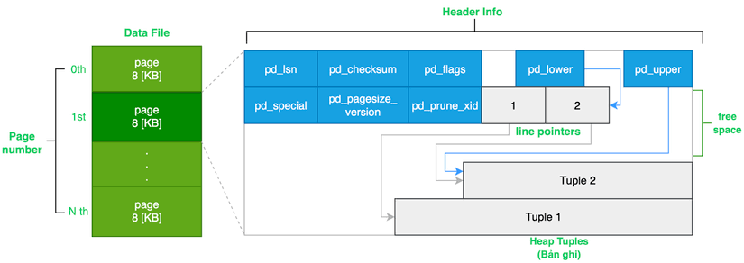
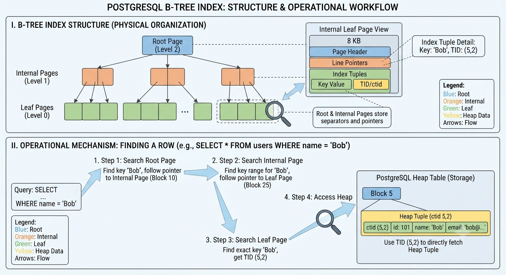
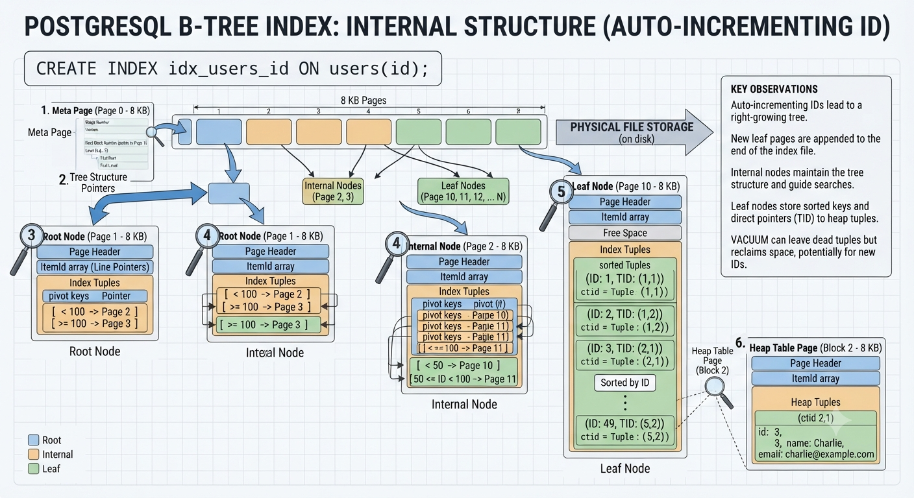
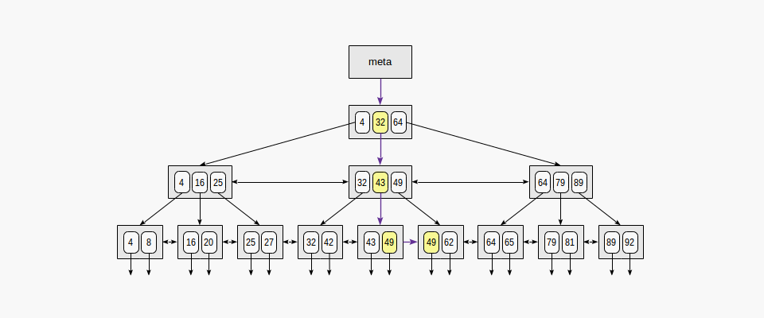
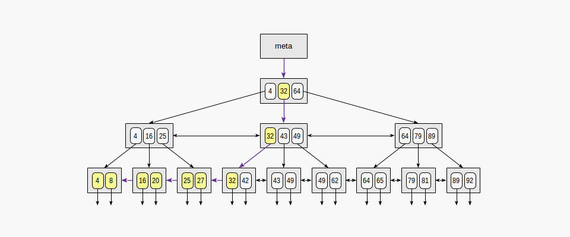
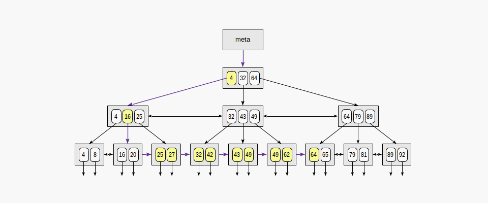
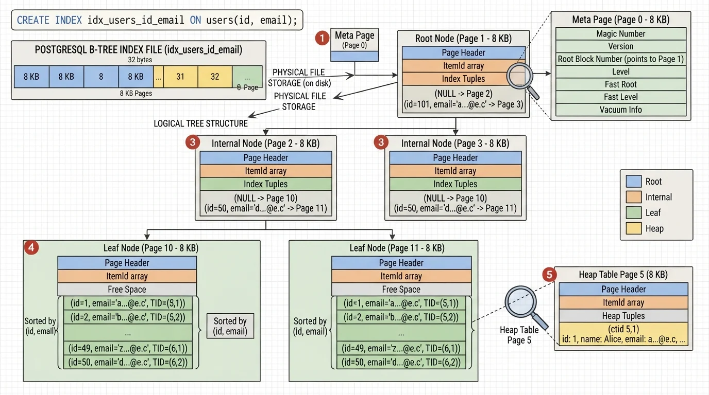

# Database Indexing

## Page, Tuple, Ctid

### Page:

- Page là đơn vị I/O cơ bản mà PostgreSQL dùng để đọc/ghi dữ liệu giữa đĩa cứng và bộ nhớ (shared_buffers).
- Kích thước mặc định của một Page là 8 KB (có thể cấu hình khi khởi tạo cluster, dù ít ai đổi).
- Bên trong một Page thường gồm các phần chính:
  - Page Header: chứa thông tin quản trị của Page (LSN, checksum, các con trỏ pd_lower, pd_upper...).
  - Line pointers (ItemId array): mảng các con trỏ trỏ tới từng Tuple trong Page.
  - Free space: vùng trống nằm giữa mảng line pointers và các Tuple.
  - Tuples: dữ liệu thực tế của các bản ghi, được ghi từ cuối Page ngược lên trên.

```
+------------------------------------------------+
|  Page Header  (24 bytes)                       |
|   LSN · checksum · pd_lower · pd_upper         |
+------------------------------------------------+
|  Line Pointer Array  (Item IDs)                |
|   [1] -> offset, length, flags                 |
|   [2] -> offset, length, flags                 |
|   [3] -> DEAD / UNUSED                         |
+------------------------------------------------+
|              Free Space                        |
+------------------------------------------------+
|  Tuple Data  (rows, bottom-up)                 |
|   HeapTupleHeader | Column values              |
+------------------------------------------------+
|  Special Space  (B-Tree sibling pointers, …)   |
+------------------------------------------------+
```



### Tuple:

- Tuple (thường gọi là heap tuple) là biểu diễn vật lý của một phiên bản bản ghi bên trong một Page.
  - Vì PostgreSQL sử dụng MVCC (Multi-Version Concurrency Control), một hàng logic trong bảng có thể tương ứng với nhiều Tuple vật lý khác nhau theo thời gian.
  - Khi bạn UPDATE một hàng, PostgreSQL không ghi đè trực tiếp lên Tuple cũ ngay lập tức mà tạo ra một Tuple mới (và đánh dấu Tuple cũ là dead tuple bằng thông tin giao dịch xmax). Các dead tuple này sẽ được dọn dẹp sau bởi VACUUM / autovacuum.
  - Mỗi Tuple có phần Tuple Header (chứa xmin, xmax, ctid, bit flags...) đi kèm phần dữ liệu cột thực tế.

### Ctid:

- ctid (Current Tuple ID) là một cột hệ thống ẩn có sẵn trên mọi bảng (trừ một số trường hợp đặc biệt như foreign table/view) trong PostgreSQL, kiểu dữ liệu là tid.

    - Giá trị ctid có dạng (block_number, tuple_index), ví dụ (0, 1) nghĩa là Page số 0 (tính từ 0) và mục thứ 1 trong mảng line pointer của Page đó.

    - Bạn có thể xem trực tiếp bằng truy vấn:

    ```SQL
    SELECT ctid, id, name FROM users;
    ```
!! ctid xác định vị trí vật lý hiện tại của Tuple, không phải khóa chính (primary key).

[!IMPORTANT] Dữ liệu bảng nằm trong heap, gồm các page 8 KB. Các dòng được lưu theo thứ tự chèn vào, không theo khóa nào cả. Mỗi dòng (tuple) có một địa chỉ vật lý gọi là ctid, dạng (số page, số slot). Bạn có thể xem bằng:
### Index

- Index là một file riêng trên đĩa, cũng gồm các page 8 KB. Nó không chứa toàn bộ dòng, mà chỉ chứa giá trị khóa và ctid để trỏ ngược về heap. Vì vậy index có thể nhỏ hơn bảng rất nhiều (khi không đưa thêm cột vào).

Một file B-Tree của PostgreSQL có ba loại page chính:
```
            [ Meta page (page 0) ]
                     |
                     v
            [ Root (internal) ]
           /         |          \
   [Internal]    [Internal]    [Internal]
     /   \          /   \          /   \
 [Leaf] [Leaf] ... [Leaf] [Leaf] ... [Leaf]  <-->  [Leaf] ...
```

- Meta page (page 0): lưu vị trí root và số tầng của cây. Đây là điểm bắt đầu của mọi lần tra cứu.
- Internal page: mỗi phần tử gồm một khóa phân tách và con trỏ (số page) xuống tầng dưới. Ví dụ, nếu một internal page có các khóa [100, 500, 900], thì bên trái 100 là một page con, giữa 100 và 500 là page khác, v.v.
- Leaf page: mỗi phần tử gồm (khóa, ctid). Các leaf nối với nhau bằng con trỏ sang trái và sang phải, nên có thể đi ngang khi cần quét một khoảng giá trị.

[!IMPORTANT] Dữ liệu trong chỉ mục được sắp xếp theo thứ tự không giảm dần (cả giữa các trang và bên trong mỗi trang), và các trang cùng cấp được kết nối với nhau bằng một danh sách hai chiều. Do đó, chúng ta có thể thu được một tập dữ liệu được sắp xếp chỉ bằng cách duyệt danh sách theo một trong hai hướng mà không cần quay lại gốc mỗi lần.





- Find "indexed-field = expression"
    - 1. Quá trình tìm kiếm bắt đầu từ nút gốc, và chúng ta cần xác định sẽ đi xuống nút con nào. Dựa trên các khóa trong nút gốc (4, 32, 64), chúng ta từ đó xác định được các khoảng giá trị trong các nút con. Vì 32 ≤ 49 < 64, chúng ta cần đi xuống nút con thứ hai. Tiếp theo, quá trình này được lặp lại theo cách đệ quy cho đến khi chúng ta đạt đến một nút lá, từ đó có thể lấy được các TID cần thiết.
    - 2. Có vẻ như chúng ta nên đi xuống từ nút nội bộ qua tham chiếu đến giá trị 49. Tuy nhiên, như có thể thấy rõ từ hình vẽ, theo cách này, chúng ta sẽ bỏ qua một trong các khóa "49" ở trang lá trước đó. Do đó, một khi đã tìm thấy một khóa hoàn toàn trùng khớp trong một trang nội bộ, chúng ta phải đi xuống một vị trí sang trái và sau đó xem xét các hàng chỉ mục của cấp độ bên dưới từ trái sang phải để tìm kiếm khóa cần tìm.

### The figure illustrates this process for n = 35:


- Find "indexed-field ≤ expression" (or "indexed-field ≥ expression"): Khi tìm kiếm theo điều kiện "trường được lập chỉ mục ≤ biểu thức" (hoặc "trường được lập chỉ mục ≥ biểu thức"), trước tiên chúng ta sẽ tìm một giá trị (nếu có) trong chỉ mục theo điều kiện bằng nhau "trường được lập chỉ mục = biểu thức", sau đó di chuyển qua các trang lá theo hướng thích hợp cho đến cuối. Các toán tử “lớn hơn” và “nhỏ hơn” cũng được hỗ trợ theo cách tương tự, ngoại trừ việc giá trị tìm thấy ban đầu phải bị loại bỏ.

### The figure illustrates this process for n ≤ 35:


- Find "expression1 ≤ indexed-field ≤ expression2": Khi tìm kiếm theo khoảng "biểu thức1 ≤ trường-chỉ-mục ≤ biểu thức2", chúng ta tìm thấy một giá trị thỏa mãn điều kiện "trường-chỉ-mục = biểu thức1", sau đó tiếp tục duyệt qua các trang lá miễn là điều kiện "trường-chỉ-mục ≤ biểu thức2" vẫn được thỏa mãn; hoặc ngược lại: bắt đầu từ biểu thức thứ hai và duyệt theo hướng ngược lại cho đến khi đạt đến biểu thức thứ nhất.

### The figure shows this process for condition 23 ≤ n ≤ 64:


### The figure shows this multiple index


## Selectivity, Cardinality & The Stats Collector

### Selectivity (Tỷ lệ chọn lọc)
Selectivity là tỷ lệ phần trăm số dòng khớp với bộ lọc của bạn.

* Công thức: (Số dòng khớp bộ lọc) / (Tổng số dòng)
* Selectivity thấp (Tốt cho Index): Tìm 1 ID tùy chỉnh trong 1.000.000 dòng (0,0001%).
* Selectivity cao (Kém cho Index): Tìm tất cả người dùng "Active" khi có tới 90% đang hoạt động.

### Cardinality (Độ phân biệt / Tính duy nhất)**
Cardinality là số lượng giá trị khác nhau trong một cột.

* Cardinality cao: UUID, Email, ID. (Rất phù hợp để đánh index).
* Cardinality thấp: Giới tính, Trạng thái, True/False. (Rất kém hiệu quả với B-Tree thông thường).

### The Statistics Collector: How Postgres "Guesses" (Bộ thu thập thống kê: Cách Postgres "đoán")

- PostgreSQL dùng Cost-Based Optimizer (trình tối ưu hóa dựa trên chi phí): nó liệt kê nhiều kế hoạch thực thi (như Seq Scan, Index Scan, Hash Join, Nested Loop), ước lượng cost (chi phí I/O và CPU) và rows (số hàng trả về) cho từng bước, rồi chọn plan có tổng cost ước tính thấp nhất.

- Để dự đoán được, PostgreSQL dựa vào:
    - Bảng thống kê hệ thống (pg_statistic / pg_stats) do lệnh ANALYZE (hoặc autovacuum) thu thập bằng cách lấy mẫu (sample) các Page trên bảng:
        1. `n_distinct`: Số lượng giá trị duy nhất ước tính / số lượng giá trị phân biệt ước lượng của cột
        2. `most_common_vals` (MCV): Các giá trị xuất hiện thường xuyên nhất.
        3. `most_common_freqs` (MCF): Tần suất xuất hiện của các giá trị đó. 
        4. `histogram_bounds`: Phân bố của các giá trị không nằm trong danh sách MCV. / phân bố dạng histogram chia các giá trị còn lại thành các khoảng đều nhau để ước lượng điều kiện range (>, <, BETWEEN).
    - Thông tin cấu trúc lưu trữ (catalog & visibility): số Page (relpages), số hàng ước lượng (reltuples), kích thước trung bình của hàng, các index hiện có và Visibility Map (để biết có thể làm Index-Only Scan hay không).
    - Tham số cấu hình cost như seq_page_cost, random_page_cost, cpu_tuple_cost, effective_cache_size...

### Ví dụ SQL thực tế: Nhìn vào bên trong "bộ não"

```sql
-- Xem thống kê cho bảng của chúng ta
SELECT
    column_name,
    n_distinct,
    most_common_vals,
    most_common_freqs
FROM pg_stats
WHERE tablename = 'large_table';
```

- Khi nào PostgreSQL dự đoán sai? (Dễ thấy khi so rows / cost của EXPLAIN với actual rows / actual time của EXPLAIN ANALYZE):

**Sự khác biệt giữa EXPLAIN (ước lượng trước khi chạy) và EXPLAIN ANALYZE (thực thi thật và đo đạc thực tế)**

    - Dù có thống kê, planner vẫn dự đoán sai trong nhiều tình huống phổ biến:
        - Thống kê bị cũ (Stale statistics): bảng vừa INSERT/UPDATE/DELETE hàng loạt nhưng autovacuum chưa kịp chạy ANALYZE lại -> reltuples và histogram lệch xa thực tế.
        - Các cột có tương quan với nhau (Correlated columns): mặc định PostgreSQL ước lượng độ chọn lọc của WHERE a = 1 AND b = 2 bằng cách nhân xác suất độc lập. Nếu country = 'VN' và language = 'vi' luôn đi cùng nhau, planner sẽ ước lượng ra số hàng ít hơn thực tế rất nhiều. (Khắc phục bằng Extended Statistics: CREATE STATISTICS ... ON a, b FROM tbl;).
        - Biểu thức, hàm hoặc ép kiểu trên cột: ví dụ WHERE LOWER(email) = 'a@b.com' hoặc WHERE created_at::date = '2026-11-01' khiến PostgreSQL khó dùng thống kê gốc của cột nếu không có expression index hoặc thống kê biểu thức tương ứng.
        - ...

## Index Scan vs. Bitmap Index Scan vs. Index Only Scan

- Index Scan duyệt trực tiếp từ cây index xuống leaf page, lấy từng ctid (hoặc dải ctid) và nhảy ngay sang Heap để đọc từng hàng một ngay trong quá trình quét.
- Bitmap Index Scan không đọc từng Heap tuple ngay khi tìm thấy ctid ở index, mà gom danh sách các vị trí thỏa điều kiện thành một bitmap (bản đồ bit theo từng Page / tuple trong Heap), rồi Bitmap Heap Scan mới đọc các Heap page theo thứ tự vật lý để giảm random I/O.
- Index-Only Scan là trường hợp tối ưu nhất khi dùng index: PostgreSQL có thể lấy toàn bộ dữ liệu cần thiết trực tiếp từ index mà không cần đọc Heap tuple — với điều kiện các cột truy vấn đều nằm trong index (kể cả cột INCLUDE) và dữ liệu được xác nhận là visible qua Visibility Map (VM).

## How WHERE, ORDER BY, and GROUP BY Influence Index Choice


### 1. The "Free" Order By

Khi bạn chạy `SELECT * FROM users ORDER BY created_at`, Postgres có hai lựa chọn:

1. **Cách vất vả:** Đọc toàn bộ bảng rồi sắp xếp trong RAM (hoặc trên đĩa nếu dữ liệu lớn). Bạn sẽ thấy một node `Sort` trong kế hoạch thực thi.
2. **Cách thông minh:** Duyệt B-Tree index trên cột `created_at` từ trái sang phải. Các dòng tự động đi ra theo thứ tự đã sắp xếp "miễn phí".

---

### 2. The "Top-N" Optimization (LIMIT)

Đây là lúc index tỏa sáng trong các API trên môi trường production. Nếu bạn có 10 triệu dòng nhưng chỉ cần lấy 10 dòng mới nhất:

* **Không có Index:** Postgres phải đọc và sắp xếp cả 10 triệu dòng chỉ để lấy top 10. Độ phức tạp $O(N \log N)$.
* **Có Index:** Postgres nhảy thẳng tới lá ngoài cùng bên phải của B-Tree và đọc 10 bản ghi. Độ phức tạp $O(\log N)$.

```text
QUERY PLAN
---------------------------------------------------------------------------------
Limit  (cost=0.42..1.56 rows=10 width=37)
  ->  Index Scan Backward on idx_created_at (cost=0.42..45678.00 rows=10000000)

```

---

### 3. Group By: Hash vs. Group Aggregate

Khi bạn gom nhóm dữ liệu (`GROUP BY category`), Postgres sẽ chọn giữa:

1. **`HashAggregate`:** Xây dựng một bảng băm (Hash Table) trong bộ nhớ (`work_mem`). Phù hợp khi có nhiều nhóm nhỏ.
2. **`GroupAggregate`:** Kỳ vọng dữ liệu đầu vào đã được sắp xếp sẵn.
Nếu có index trên cột dùng để gom nhóm, Postgres có thể dùng `GroupAggregate` — tốn rất ít bộ nhớ và cực nhanh với tập dữ liệu lớn vì chỉ cần xử lý tuần tự trên luồng dữ liệu đã sắp xếp.

---

### 4. Multi-clause Interaction

Điều gì xảy ra nếu bạn kết hợp cả hai: `WHERE status = 'active' ORDER BY created_at`? Để đạt được `Index Scan` (không cần `Sort`), bạn cần một **Composite Index** trên `(status, created_at)`.

* Nếu bạn đánh index `(created_at, status)`, Postgres không thể dùng index này tối ưu cho cả hai cùng lúc. Nó sẽ phải quét toàn bộ cây cho phần `ORDER BY`.
* Nếu bạn đánh index `(status, created_at)`, Postgres tìm tất cả các dòng `'active'` (được gom cụm cạnh nhau trong cây) và nhận thấy chúng đã được sắp xếp theo `created_at` ngay bên trong nhóm đó. Quá chuẩn.


## Data Alignment & Padding (Staff-Level Performance) - Căn chỉnh và đệm dữ liệu (Hiệu năng ở cấp độ hệ thống/phần cứng)

CPU và cấu trúc bộ nhớ của PostgreSQL yêu cầu các giá trị có kích thước nhất định phải bắt đầu ở địa chỉ (tính theo offset tương đối / biên cấu trúc) chia hết cho alignment boundary của kiểu dữ liệu đó (typalign trong pg_type):

    - char (1 byte): align 1 byte (boolean, char) — đặt ở đâu cũng được.
    - short / int2 (2 bytes): align 2 bytes (smallint, int2) — offset chẵn.
    - int / int4 (4 bytes): align 4 bytes (integer, real, date, oid) — offset chia hết cho 4.
    - double / int8 (8 bytes): align 8 bytes (bigint, double precision, timestamp, timestamptz, interval, numeric header/digits tùy cấu trúc) — offset chia hết cho 8.
    => Nếu một giá trị yêu cầu align 8 bytes mà vị trí hiện tại đang ở byte offset 19, PostgreSQL phải chèn 5 bytes padding (thường là byte 0x00) để bắt đầu tại byte 24.

Mỗi kiểu dữ liệu có alignment requirement
Example:
| Type | Size | Alignment |
| ------ | ------- | ------------------ |
| `int2` | 2 bytes | 2-byte aligned |
| `int4` | 4 bytes | 4-byte aligned |
| `int8` | 8 bytes | **8-byte aligned** |

Rule:
Giá trị phải bắt đầu ở offset là bội số của alignment

```sql
-- Bad Design (Wasteful)
CREATE TABLE wasteful (
    id int2,      -- 2 bytes
    val int8,    -- 8 bytes (Needs 6 bytes of padding before it)
    status int2   -- 2 bytes
);
=> offset 0-1: int2 id
=> offset 2-9: padding (val int8 cần 8-byte alignment Offset hiện tại = 2 và Bội số gần nhất của (8,2) là 8 => **PostgreSQL phải chèn padding để đảm bảo rằng giá trị val bắt đầu ở offset là bội số của alignment**)
=> offset 10-17: int8 val
=> offset 18-19: int2 status
-- Each row wastes ~6 bytes. At 1 Billion rows, this is 6GB of wasted RAM/Disk.

-- Good Design (Compact)
CREATE TABLE compact (
    val int8,    -- 8 bytes
    id int2,      -- 2 bytes
    status int2   -- 2 bytes
);
```

--- 

## Query Planner Internals & Cost Estimation

### 1. The Query Lifecycle

Trước khi một câu truy vấn được thực thi, nó đi qua năm giai đoạn:

1. Parser (Bộ phân tích cú pháp): Kiểm tra cú pháp SQL.
2. Analyzer (Bộ phân tích ngữ nghĩa): Kiểm tra xem các bảng/cột có tồn tại và hợp lệ hay không.
3. Rewriter (Bộ viết lại truy vấn): Xử lý các View và Rule.
4. Planner / Optimizer ("Bộ não"): Tạo ra nhiều "đường đi" (Paths) khác nhau và tính toán chi phí (cost) của từng phương án.
5. Executor (Bộ thực thi): Thực sự chạy phương án có chi phí thấp nhất.

---

## 2. The Cost Model (The Math)

Postgres không dùng "giây" để đo chi phí (cost). Nó sử dụng một đơn vị quy ước, trong đó 1.0 là chi phí để đọc tuần tự một trang dữ liệu (page) kích thước 8KB từ đĩa.

### Công thức cơ bản::

Total Cost = (I/O Cost) + (CPU Cost)

- I/O Cost: number of pages × seq_page_cost (1.0).
- CPU Cost: number of tuples × cpu*tuple_cost (0.01).
  Example: A 1,000-page table with 10,000 rows. Cost = (1000 * 1.0) + (10000 \_ 0.01) = 1,100.0

---


## 3. The "Random I/O" Penalty

This is the most important setting for a Engineer.

- seq_page_cost: 1.0 (Default)
- random_page_cost: 4.0 (Default)

Postgres mặc định rằng việc đọc từ index (Random I/O) tốn kém gấp 4 lần so với quét tuần tự (Sequential Scan). Điều này đúng với các ổ cứng cơ quay (HDD).

## [!IMPORTANT] Tinh chỉnh cho ổ Flash/SSD hiện đại: Trên ổ NVMe SSD hiện nay, chi phí phạt cho Random I/O gần như bằng 0. Hầu hết các Staff Engineer đặt random_page_cost = 1.1 (hoặc khoảng 1.1–1.2). Điều này khuyến khích bộ lập kế hoạch truy vấn (planner) sử dụng index mạnh mẽ hơn ngay cả khi tập kết quả trả về lớn hơn.

---
## 4. Path Selection & The GEQO

Đối với một câu SELECT đơn giản, chỉ có một vài đường đi (path). Nhưng với một phép join 10 bảng, có tới hàng triệu tổ hợp có thể xảy ra.

- Quy hoạch động (Dynamic Programming): Với các phép join nhỏ (dưới 12 bảng), Postgres sẽ kiểm tra mọi khả năng có thể.
- GEQO (Genetic Query Optimizer – Bộ tối ưu hóa truy vấn di truyền): Với các phép join phức tạp, Postgres sử dụng thuật toán di truyền để "tiến hóa" ra một kế hoạch đủ tốt, vì việc kiểm tra toàn bộ các đường đi sẽ tốn nhiều thời gian hơn cả bản thân câu truy vấn.

---

```
Ở cấp độ sâu hơn về **Query Planner Internals & Cost Estimation**, câu hỏi cốt lõi không chỉ là "PostgreSQL dùng thống kê gì", mà là **bên trong Planner diễn ra những pha nào**, **công thức ước lượng cost & selectivity vận hành ra sao**, và **vì sao không gian tìm kiếm kế hoạch (search space) bùng nổ khi query có nhiều JOIN**.

---

### 1. Kiến trúc bên trong của Planner & Optimizer

Khi một câu SQL đi qua Parser/Analyzer/Rewriter và tới **Planner**, nó trải qua các giai đoạn chính sau:

* **Preprocessing & Query Rewrite ở mức Plan**:
* Làm phẳng subquery/CTE (khi được phép), suy diễn điều kiện bắc cầu (*transitive closure*, ví dụ `a = b AND b = 5` → suy ra `a = 5`), chuẩn hóa biểu thức/hàm, loại bỏ điều kiện luôn đúng/luôn sai (`WHERE 1 = 0` hoặc `x > 10 AND x < 5` → `Result` rỗng).
* Phân vùng (*Partition Pruning*): loại trừ các partition không khớp điều kiện `WHERE` ngay ở bước lập kế hoạch (hoặc cả khi thực thi với *run-time pruning*).


* **Access Paths cho từng bảng (`reloptinfo`)**:
* Với mỗi bảng (hoặc join subset), Planner sinh ra các **Path** ứng viên: `Seq Scan`, `Index Scan`, `Index-Only Scan`, `Bitmap Heap Scan`, `Tid Scan`, v.v.
* Mỗi `Path` chỉ giữ lại thông tin cần thiết để so sánh (khác với `Plan` hoàn chỉnh): **chi phí khởi tạo (`startup_cost`)**, **tổng chi phí (`total_cost`)**, **số hàng ước lượng (`rows`)**, **thứ tự sắp xếp đầu ra (`pathkeys`)**, và **tập các bảng tham gia**.
* Nếu một `Path` có cả `startup_cost` lẫn `total_cost` **kém hơn** một `Path` khác cùng `pathkeys` và cùng phạm vi dữ liệu, nó sẽ bị loại bỏ sớm (*pruned*).


* **Join Planning & Dynamic Programming / GEQO**:
* Khi join nhiều bảng, thứ tự join và thuật toán join (**Nested Loop**, **Hash Join**, **Merge Join**) ảnh hưởng cực lớn đến số hàng trung gian.
* Với số lượng bảng vừa phải (dưới `geqo_threshold`, mặc định `12`), PostgreSQL dùng **Dynamic Programming** (tìm theo kích thước tập join: 2 bảng, 3 bảng... và giữ các path tốt nhất/cần thiết cho `pathkeys`).
* Khi số bảng vượt `geqo_threshold`, nó chuyển sang **GEQO** (*Genetic Query Optimizer* — thuật toán di truyền) để tránh bùng nổ tổ hợp.


---

### 2. Công thức Cost & Selectivity hoạt động như thế nào?

#### Startup Cost vs. Total Cost

* **`startup_cost`**: chi phí để trả về **hàng đầu tiên** (ví dụ: chi phí dựng hash table cho *Hash Join*, chi phí sort toàn bộ dữ liệu trước khi trả hàng đầu cho *Sort* hoặc *Merge Join*). Với `Seq Scan` hoặc `Index Scan`, `startup_cost` thường rất nhỏ hoặc bằng `0`.
* **`total_cost`**: tổng chi phí để đọc/xử lý **toàn bộ tập kết quả** của node đó.
* **Ảnh hưởng của `LIMIT**`: khi có `LIMIT k`, Planner không chỉ nhìn `total_cost` toàn tập mà tính chi phí tỷ lệ theo `k` hàng đầu tiên — đó là lý do `LIMIT 1` thường kéo Planner về `Index Scan` + `ORDER BY` thay vì `Hash Join` + `Sort`.

#### Cách tính Cost cơ bản (I/O + CPU)

Planner cộng dồn chi phí I/O (đọc page) và chi phí CPU (xử lý từng tuple / từng biểu thức):

* **Sequential Scan**:
* I/O cost tỷ lệ với `relpages * seq_page_cost`.
* CPU cost tỷ lệ với `reltuples * cpu_tuple_cost + reltuples * cpu_operator_cost` (chi phí đánh giá điều kiện `WHERE`).


* **Index Scan**:
* I/O cost phụ thuộc vào số index page đọc được và **số heap page ước tính phải truy cập**, được điều chỉnh bởi `correlation` giữa thứ tự index và thứ tự vật lý trên Heap (nếu `correlation` gần `±1`, các hàng liên tiếp nằm gần nhau trên đĩa nên tiệm cận `seq_page_cost`; nếu gần `0`, mỗi hàng có thể là một lần `random_page_cost`).
* CPU cost gồm `cpu_index_tuple_cost` cho mỗi index entry được duyệt và `cpu_tuple_cost` cho mỗi heap tuple đọc lên.


#### Selectivity (Độ chọn lọc) & Ước lượng `rows`

**Selectivity** là tỷ lệ hàng thỏa điều kiện (`0.0` đến `1.0`), và:

$$\text{estimated\_rows} = \text{reltuples} \times \text{selectivity}$$

* **So sánh bằng (`col = const`)**:
* Nếu `const` nằm trong `most_common_vals` (MCV): dùng trực tiếp tần suất tương ứng trong `most_common_freqs`.
* Nếu không nằm trong MCV: ước lượng dựa trên phần xác suất còn lại chia đều cho số giá trị phân biệt còn lại (`n_distinct`).


* **So sánh khoảng (`col > const`, `col BETWEEN a AND b`)**:
* Tính phần nằm trong MCV + nội suy tuyến tính trên các bucket của `histogram_bounds` (nếu giá trị nằm ngoài `histogram_bounds`, Planner dùng heuristic/nội suy biên, dễ lệch nếu dữ liệu mới sinh ra liên tục).


* **Kết hợp nhiều điều kiện (`AND` / `OR`)**:
* Với `col1 = x AND col2 = y` (mặc định giả định độc lập): $s(A \cap B) \approx s_A \times s_B$.
* Với `col1 = x OR col2 = y`: $s(A \cup B) \approx s_A + s_B - s_A \times s_B$.


---

### 3. Tại sao sai số `rows` lại phá vỡ toàn bộ Query Plan?

Vì Planner chọn **Join Algorithm** và **cấp phát bộ nhớ (`work_mem` / `hash_mem`)** dựa trên `rows` ước lượng:

* **Ước lượng quá thấp (`rows` nhỏ, thực tế lớn)**:
* Planner có thể chọn **Nested Loop Join** thay vì **Hash Join** hoặc **Merge Join**. Nếu outer/inner lớn hơn dự đoán nhiều lần, Nested Loop có thể nhân số lần lặp lên rất cao.
* Hoặc chọn *Index Scan* rồi nhảy random I/O trên hàng triệu Heap tuple thay vì quét tuần tự (*Seq Scan* / *Bitmap Scan*).


* **Ước lượng quá cao (`rows` lớn, thực tế nhỏ)**:
* Planner có thể chọn **Seq Scan** hoặc **Hash Join** (tốn công build hash table cho tập dữ liệu thực ra rất nhỏ), hoặc cấp phát quá tay khiến spill ra đĩa / tính toán sai thứ tự join.


---

### 4. Cách kiểm soát & debug Planner ở cấp độ nâng cao

* **Đọc `EXPLAIN (ANALYZE, BUFFERS)**`: thêm `BUFFERS` để thấy số `shared hit` (lấy từ `shared_buffers`) và `shared read` (đọc từ OS cache / disk) — phản ánh I/O thực tế sát hơn nhiều so với chỉ nhìn `cost` thuần túy.
* **Bổ sung thống kê cho tương quan / biểu thức**: dùng `CREATE STATISTICS` cho các nhóm cột phụ thuộc nhau, và tạo *expression index* khi hay lọc theo biểu thức/hàm.
* **Chỉ dùng `enable_*` (như `enable_seqscan = off`, `enable_nestloop = off`) để chẩn đoán/test**, không bật tắt vĩnh viễn trong production nếu chưa hiểu rõ hệ quả (vì `enable_* = off` không cấm hoàn toàn mà cộng thêm mức phạt cost rất lớn `1.0e10` vào node đó).
```

Refers: https://postgrespro.com/blog/pgsql/4161516